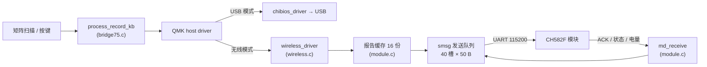
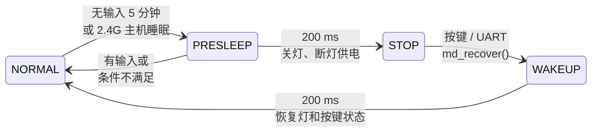

# 架构与设计

给改代码的人看。说明硬件、源码结构、各子系统的工作方式、关键常量、做过的设计取舍和已知风险。行号会变，引用时以函数名为准。

## 1. 硬件

| 部件 | 说明 |
| --- | --- |
| 主控 | WB32FQ95（西风 Cortex-M3），引导程序 `wb32-dfu`，USB `FFFE:003E` |
| 无线模块 | CH582F，**闭源固件**，经 UART1 通信，115200 baud。负责蓝牙 1–3（协议支持到 5，本固件只用 1–3）和 2.4G |
| 存储 | SPI flash 上的 wear-leveling EEPROM，8 KB |
| 灯 | 6 颗 WS2812：Caps(0)、Esc(1)、BT1(2)、BT2(3)、BT3(4)、2.4G(5) |
| 关键引脚 | B7 灯供电使能（低有效）；A14 USB 供电使能（低 = 接通）；B8 线缆检测（高 = 插线）；B9 充电检测（低 = 充电中） |

## 2. 源码结构

```
keyboards/shortcut/
├── bridge75/                 板级：本键盘专有
│   ├── bridge75.c            Fn 功能键、配对计时、EEPROM、状态灯、诊断输出、开机恢复
│   ├── info.json             公共配置与 8 个自定义键位（顺序 = VIA 定义顺序）
│   ├── config.h / halconf.h / mcuconf.h
│   └── ansi_norgb/           变体：keyboard.json、config.h（常量覆盖）、rules.mk、keymaps/default
└── wireless/                 无线库：源自厂商 RC8，可复用
    ├── wireless.c/.h         总入口、电量查询、housekeeping 钩子
    ├── transport.c/.h        USB ↔ 无线切换、USB 挂起与远程唤醒
    ├── module.c/.h           UART 帧收发、ACK、重试、报告缓存、重连
    ├── smsg.c/.h             发送队列（环形缓冲）
    ├── lowpower.c/.h         MCU 休眠状态机（平台无关）
    ├── lpwr_wb32.c           WB32 的 STOP 进入与恢复（含厂商机器码）
    ├── md_raw.c/.h           厂商的 RAW HID 隧道，本固件不编译
    ├── battery_custom.c
    ├── wireless.mk
    └── tests/                主机回归测试
tools/bridge75/build.sh       在 QMK checkout 内执行的构建脚本
build.sh                      同步本仓库到 QMK checkout 后调用上面的脚本
```

代码来源：原项目（板级适配）+ 厂商 RC8（无线库）→ 移植到官方 QMK `33292390974c75362ca30873c482d052e0bd7a63`。不改 QMK 核心。

两个上游参考已经移植完毕，本机不再保留；需要对照时按下表重新 clone（都在 GitHub `emolitor/qmk_firmware` 这个 fork 上）：

| 参考 | 用途 | 获取 |
| --- | --- | --- |
| 原项目 | 板级适配。核对引脚、灯供电极性、键位；另有 `bridge75`（带灯）、`bridge75_iso` 变体。旧目标 `shortcut/bridge75_nolight`，无线代码在 `modules/westberry/wireless` | `git clone -b em-bridge75 https://github.com/emolitor/qmk_firmware.git qmk_firmware-em-bridge75`，再 `git checkout da9e806e39` |
| 厂商 RC8 | 无线库原版。查模块命令、串口帧、STOP 寄存器；无线代码在 `keyboards/shortcut/wireless` | `git clone -b wireless https://github.com/emolitor/qmk_firmware.git qmk_wireless_rc8`，再 `git checkout c0f86de489` |

两个都是完整的 QMK 仓库（几百 MB），只看个别文件时可以在 GitHub 网页上按提交号浏览。



## 3. USB 与无线切换（`transport.c`）

- 切到无线：先给 USB 主机发空报告（松开所有键），再 `usbStop` + `usbDisconnectBus`，拉高 A14 断开 USB 供电，host driver 换成 `wireless_driver`。**无线模式下 USB 完全断开**，所以 VIA 不可用。
- 切到 USB：拉低 A14、等 5 ms、重启 USB 驱动，换回 `chibios_driver`。
- 切换设备前按 ACK 顺序发出各类"全部松开"帧；旧链路已断时，无法保证旧主机收到松开。
- 当前设备存在 EEPROM（`confinfo.devs`），每次切换都写入。
- **开机顺序**：QMK 的 `protocol_post_init()` 在 `keyboard_post_init_kb()` 之后才安装 USB host driver，会覆盖早先设置的无线驱动。所以保存的无线模式放到第一次 housekeeping（`wireless_post_task`）才恢复。
- USB 挂起 7 秒后进入 `suspend_power_down()`；主机允许时才发远程唤醒。

## 4. 无线协议（`module.c`、`smsg.c`）

### 4.1 发送

按键报告先进**报告缓存**（16 份，超过 5 秒未发出视为过期丢弃），再打包进 **smsg 队列**（40 槽，每槽最多 50 字节，环形缓冲留空一槽，实际可用 39）。队列一次只发一帧，等模块回 ACK 后再发下一帧。

### 4.2 接收

每个循环先处理 RX，再处理发送超时。模块发来的帧：ACK 固定 `61 0D 0A`；状态、电量、版本等消息为 3 字节带校验（`valid`/`bad` 计数）。RX 半帧超过 20 ms 丢弃。

### 4.3 ACK 对账

**模块的 ACK 不带序号**，这是整个协议最微妙的地方。

- 问题：一帧超时重发后，第一份的迟到 ACK 可能被当作下一帧的 ACK。若下一帧其实没送达，丢的可能是"松开"报告，主机就会认为键一直按着。
- 做法（ack 版起）：每发一次记一笔"欠账"；一帧确认后多出来的 ACK 记为欠账，之后先抵欠账再确认新帧。欠账在 100 ms 内没有新 ACK 就作废（`MD_STALE_ACK_WINDOW`）。
- 防连锁：若欠的那份 ACK 其实丢了，下一帧的 ACK 会被误抵，导致后面一串帧各多等一次。修正为：一帧抵过欠账后又超时，就把抵掉的那份算作自己的 ACK。2227 构建没有这一条，实测出现 `tx=20 retries=10`。
- 重发超时 30 ms（早期 10 ms，实测 ACK 常晚于 10 ms 到达），最多 40 次，模块完全无响应时约 1.2 秒判定断开。
- **已知取舍**：每丢一份会让两个报告各晚约 30 ms。要降到只晚一次就得冒 ACK 错配丢帧的风险，**不要改回去**。

### 4.4 重连与电量

- 断线期间重新选择设备并发送配置，间隔从 500 ms 起翻倍，封顶 10 秒；按键、收到已连接、重试耗尽、切换设备、STOP 唤醒都会重置为 500 ms。只在无线模式、非配对中、且有待发数据时退避。
- 电量查询：开机立即一次，之后每 30 秒一次，只在无线模式且未进入低功耗时。Fn+B 只读缓存值，不发查询。

### 4.5 配对与模块设置（`bridge75.c`）

- Fn+1–4 按下立即切换（不配对），记下计时；**仍按住满 1000 ms** 时发一次 `PAIR`。不发 `CLEAN`，所以不会清模块里其他槽的配对。
- 板级覆盖了库里的 `md_devs_change`，配对时只发设备选择和 `PAIR`。
- 每次模块恢复（`md_recovery_kb`）后重发蓝牙名（`config.h` 的 `MD_BT_NAME`），约 100 ms 后重新下发模块休眠开关（命令 0x55–0x58，模块侧 30 分钟超时）。

## 5. 低功耗（`lowpower.c`、`lpwr_wb32.c`）



- **允许休眠的条件**：无线模式（USB 模式且 USB 活动时不睡）；**没插线**（B8 为低）；队列空、无待发报告、无按键按住；无输入满 `LPWR_TIMEOUT`（300 秒），或 2.4G 主机报告睡眠（提前休眠）。PRESLEEP 期间任一条件被破坏就回到 NORMAL。
- **进入 STOP**：矩阵行配置为下降沿 EXTI、列拉低；UART RX 双沿唤醒。最后检查一遍行线、线缆、EXTI 挂起，有任何一个就不睡。
- **唤醒源**：按键（`source=1`）、模块消息（`source=2`）。线缆只在入睡前检查，没有对应 EXTI。
- **醒来后**：恢复时钟、矩阵引脚，用 `sdStop/sdStart` 重启串口（QMK 的 `uart_init()` 只初始化一次），调用 `md_recover()` 重置链路（状态置为断开、重发版本查询和设备选择，等模块重新上报"已连接"）。
- **保留首键**：STOP 返回后矩阵扫描可能先于延迟的恢复回调运行，所以恢复时调用 `suspend_wakeup_init_quantum()`，保留已扫描到的按键和修饰键。按键按住时不进入休眠。
- **`_resetwake` 变体**：编译时 `WB32_WAKE_RESET_HACK=yes`，唯一区别是 STOP 唤醒后立即 `NVIC_SystemReset()`。这是厂商原始做法，会丢 RAM（计数清零）和首键缓冲，只作回退对照。

## 6. EEPROM 布局（键盘区 `confinfo`）

| 位 | 字段 | 说明 |
| --- | --- | --- |
| 0–2 | `devs` | 当前设备：0 USB、1–3 蓝牙、6 为 2.4G（4、5 视为无效） |
| 3 | `module_sleep` | 模块休眠开关 |
| 4–7 | 保留 | |
| 8–15 | `version` | 固定 `0xB7`；不符时整块重置为默认（USB、休眠关） |

- 默认层只接受 Windows（层 0）或 Mac（层 2），其他值开机时改为 Windows 并写回。
- 状态灯不读 EEPROM 里的 RGB 设置（`configure_status_leds` 不写 EEPROM），旧的 RGB 关闭设置不会让灯不亮。
- Fn+Esc（`EE_CLR`）：QMK `eeconfig_init()` 清空全部设置，VIA 下会重置动态键图，然后切到 USB。不清模块里的配对。

## 7. VIA

- `VIA_ENABLE` 放在 `keymaps/default/rules.mk`：`qmk lint` 禁止键盘级 VIA，keymap 目录也不能叫 `via`。QMK 自动打开 `RAW_ENABLE`、`DYNAMIC_KEYMAP_ENABLE`。
- `ansi_norgb/rules.mk` 声明 `BRIDGE75_USB_RAW_HID = yes`；`wireless.mk` 在没有这个声明时拒绝 `RAW_ENABLE`，并在声明时不编译 `md_raw.c`（厂商按源码行号改写函数名的 RAW 隧道）。
- 自定义键位 8 个，`info.json` 的 `keycodes` 顺序必须与 `docs/via/bridge75-norgb-via.json` 的 `customKeycodes` 一致，才能对上 `QK_KB_0…7`。CI 会核对名称列表、数量和 VID/PID。**不要加没有处理函数的键位**（via 版曾为保持索引放过 4 个占位键，via2 已删除）。
- VIA 的 EEPROM 校验值随构建时间变化，每次刷新构建都会重置键图。

## 8. 诊断输出

`bridge75.c` 里 `BR_DIAG`、`BR_BAT` 只设置标志，由 `wireless_housekeeping_kb` 在条件满足时生成文本（320 字节缓冲）并每 30 ms 发一个字符。前缀 `"bridge75-" BRIDGE75_BUILD`，`BRIDGE75_BUILD` 由 `ansi_norgb/rules.mk` 从 make 变量注入，默认 `"dev"`。字段含义见[诊断与实机测试](诊断与实机测试.md#2-字段)。

## 9. 关键常量

| 常量 | 值 | 位置 | 作用 |
| --- | --- | --- | --- |
| `LPWR_TIMEOUT` | 300000 ms | `ansi_norgb/config.h` | 无输入多久进入休眠 |
| `LPWR_PRESLEEP_DELAY` / `STOP_DELAY` / `WAKEUP_DELAY` | 200 ms | `lowpower.c` | 状态机各段延时 |
| `MD_SNED_PKT_TIMEOUT` | 30 ms | `module.c` | ACK 超时（宏名拼写如此） |
| `MD_SEND_PKT_RETRY` | 40 | `module.c` | 最大重发次数 |
| `MD_STALE_ACK_WINDOW` | 100 ms | `module.c` | 欠账作废时间 |
| `MD_RECONNECT_MIN` / `MAX` | 500 / 10000 ms | `module.c` | 重连退避 |
| `MD_REPORT_COUNT` | 16 | `module.c` | 报告缓存份数，过期 5000 ms |
| `SMSG_NUM` / `SMSG_PAYLOAD_LEN` | 40 / 50 | `smsg.c` | 发送队列 |
| `MD_BAUD_RATE` | 115200 | `module.c` | UART |
| `WLS_INQUIRY_BAT_TIME` | 30000 ms | `ansi_norgb/config.h` | 电量查询（库默认 3000） |
| 配对长按 | 1000 ms | `bridge75.c` | |
| `USB_POWER_DOWN_DELAY` | 7000 ms | `transport.c` | USB 挂起后多久断电 |
| `rgb_matrix.timeout` | 60000 ms | `keyboard.json` | 灯闲置熄灭 |

改 `SMSG_NUM`/`SMSG_PAYLOAD_LEN` 前先想清楚：环形缓冲的正确性依赖未写明的容量关系，目前靠百万次队列模型测试兜底。

## 10. 主机回归测试

测试把真实源码 `#include` 或抽取进主机程序，配合桩函数和模拟时间运行，不需要 ARM 工具链：

| 套件 | 命令 | 覆盖 |
| --- | --- | --- |
| 无线协议 | `sh keyboards/shortcut/wireless/tests/run.sh` | 帧解析、重试上限、报告重放、NKRO、切换与恢复、诊断计数、迟到/重复 ACK、丢包不连锁、重连退避、电量查询、百万次队列模型。内含可丢包、延迟回 ACK 的模拟模块 `sim_module` |
| 低功耗与 USB | `python3 keyboards/shortcut/wireless/tests/lowpower/run.py` | 按键按住、待发报告、预休眠期间输入、STOP 取消、UART 恢复、唤醒计数；USB 远程唤醒许可、每次挂起只请求一次 |
| 板级启动 | `python3 keyboards/shortcut/wireless/tests/board/run.py` | 延迟恢复传输、设备与名称顺序、灯与供电恢复、默认层校验、100 ms 配置延时（含计时器回绕）、BT_USB/EE_CLR、输出类型 |

不覆盖：配对 1 秒长按计时、寄存器与时钟、WS2812 时序、闭源模块的真实行为。这些只能实机验证。

改协议、低功耗、报告队列时必须补测试，并确认新测试在旧代码上会失败。AddressSanitizer 在本机无法运行，测试用 UBSan。

## 11. 设计取舍与排查结论

- **先复现再改。** 最初怀疑 smsg 队列覆盖，百万次随机队列操作没有复现，队列保持原样。真正的边界是：ACK 在重试耗尽前已到达 RX，旧代码却先处理超时。改为先处理 RX，并在重试状态接受有效 ACK。
- **RC8 的 `LT(0, 自定义键)` 会截断键码**，改为直接键码加长按计时。
- **复位唤醒不是"无损唤醒"**，默认构建用软唤醒。
- **旧问题的根因未单独证实。** 旧固件开着模块 30 分钟休眠，时间与症状吻合；RC8 的复位唤醒路径也可能造成停顿或丢首键。diag3 同时改了两者，所以它的通过只能证明"模块休眠关 + 软唤醒"这个组合。要拆开验证，用同一固件对比 `sleep=0`/`sleep=1`（测试 T12）。
- **两级休眠要分清**：MCU STOP（5 分钟，固件控制）和模块休眠（30 分钟，闭源模块控制，Fn+` 开关）。
- **`fw=0`**：读不到模块版本，但蓝牙正常、`ack`/`valid` 照常增长，不是模块故障。
- **灯和无线分开验证**：诊断里 `rgb`/`leds`/`rail` 只说明代码走到哪一步，实际亮不亮要肉眼看。

## 12. 已知风险

| 风险 | 说明 |
| --- | --- |
| STOP 恢复依赖厂商机器码 | `lpwr_wb32.c` 的 `PRE_LP`/`POST_LP` 无法审查；QMK 没有看门狗，恢复失败会卡死直到断电 |
| 每次唤醒都重置链路 | 依赖模块重新上报"已连接"；2.4G 下未实测 |
| 醒着时全速运行 | MCU 在 5 分钟内全速；灯供电直到休眠前才切断 |
| 2.4G `drops=76` | ack 2237 实测出现，来源未查明 |
| 切主机时的松开帧 | 旧链路已断时无法保证旧主机收到松开 |
| 无线不支持 VIA | 设计如此；需要改键请用有线 |
